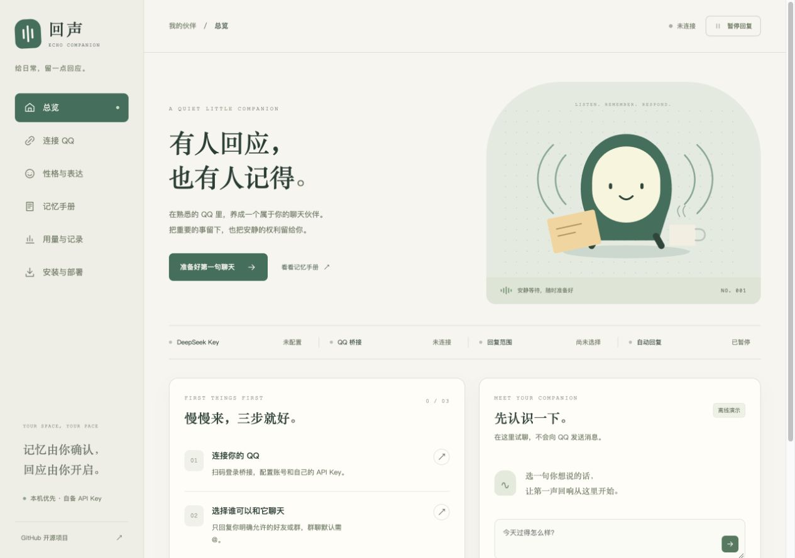

# 回声 · Echo Companion

**记忆可核对，平时不打扰。** 一个使用用户自备 DeepSeek API Key、运行在自己电脑上的 QQ 聊天伙伴。

回声是独立实现的实验项目。产品设计参考了 QQ 机器人社区关于记忆、刷屏、配置和调用成本的公开讨论；源码不以此前试装的 `dafeiyu-bot` 为基础，也不包含它的角色图片或人设素材。研究证据与设计取舍见 [产品调研](docs/PRODUCT_RESEARCH.md)。

> **当前状态：实验版。** 提供本机控制面板、离线演示、模型接入与 QQ 桥接流程。真实模型、真实 QQ 对端收信和 Windows/macOS 安装体验需要分别验收；不能将合成测试通过当成真实聊天已通过。多人托管网站尚未实现。



## 为谁准备

想在自己的 QQ 上使用一个有稳定设定、能记住经过确认的信息、可以随时暂停的聊天伙伴。回声先把文字聊天做清楚：

- **先试聊，再接 QQ：** 离线演示不调用模型；真实试聊使用自己的 Key，会产生模型调用。
- **每个会话有自己的边界：** 明确选择允许回复的好友或群，默认不主动插话。
- **记忆经过确认：** 用户可以查看、批准和删除记忆，不把模型的推测直接当成事实。记忆删除会使正在使用旧上下文的任务失效。
- **调用看得见：** 显示调用尝试与供应商实际返回的用量；供应商没有返回用量时标记未知。每日上限约束调用尝试，失败也计入。
- **控制留在本机：** 控制服务只绑定 `127.0.0.1`，需要启动时生成的控制凭证；JSON API 使用 `X-Echo-Token` 验证。API Key 可仅保存在进程内存，或由 `DEEPSEEK_API_KEY` 环境变量提供。

## 快速开始

需要 **Node.js 22.13 或更新版本**。建议从 [Node.js 官方网站](https://nodejs.org/) 安装当前受支持的 LTS。无需 Swift，也不需要先安装完整机器人框架。

下载仓库并在项目目录执行：

```sh
git clone https://github.com/youseff37/echo-companion.git
cd echo-companion
npm ci --ignore-scripts
npm run doctor
npm start
```

终端会打印本机控制地址，默认端口为 `8787`。请打开**完整控制地址**，其中含有本次启动的控制凭证；不要分享该地址或把它贴到公开 Issue。

第一次可以先使用有明确标识的**离线演示**，检查人设编辑和操作流程。演示内容不是 DeepSeek 的实际回复，也不能证明 QQ 已连接。

在面板中填写自己的 API Key 后，可以进行真实试聊。普通真实预览按一次模型调用设计，可能计费，也受每日调用上限约束。支持 `deepseek-chat` 与 `deepseek-reasoner`。Key 不需要交给帮助安装的 AI。

### 接入 QQ

使用**专门的机器人 QQ 账号**，不要以日常主账号作为首次测试账号。桥接依赖第三方 NapCat，可能遇到平台风控、掉线或重新扫码，不承诺持续在线。

先安装并启动 Docker。Mac 和 Windows 通常使用 Docker Desktop；Windows 使用 Linux 容器。然后在本仓库执行：

```sh
npm run bridge:init
npm run bridge:start
```

初始化生成的私有配置位于 `.runtime/napcat/config`。在本机打开 `http://127.0.0.1:6099/webui/`，按脚本提示使用 WebUI 令牌进入，手机 QQ 扫码。WebUI 令牌和 OneBot 令牌用途不同。

回到回声面板，配置实际机器人 QQ 号、OneBot 地址 `ws://127.0.0.1:3001` 和 OneBot 令牌。连接并核对账号，选定一个允许测试的好友或群，再进行单次验收。群聊使用 QQ 的真正 `@` 选择器。

**接口确认发送不等于接收者已看到消息。** 验收以对端实际收到为准；结果未知时不要反复点击发送。

完整操作和安装 AI 的职责边界见 [AI 安装说明](docs/AI_INSTALL.md)。

## 本机与服务器，两条使用路径

| 路径 | 适用范围 | 状态与边界 |
|---|---|---|
| 自己电脑运行 | 一位拥有者、自己的 Key 和机器人 QQ | 当前产品路径；电脑需要保持运行 |
| 自己服务器运行 | 单一拥有者维护一个实例 | 技术上可行，先通过 SSH 隧道访问本机控制端口；需要独立验收 |
| 登录网站后由平台托管多个用户的 QQ | 多租户商业服务 | **尚未实现**；不能通过改监听地址把本机版变成托管平台 |

详见 [服务器与托管说明](docs/HOSTING.md)。

## 开发与验证

```sh
npm ci
npm test
npm run doctor -- --json
```

测试使用合成事件、临时数据和模拟外部接口。执行测试不应向真实好友或群发消息，不应消耗真实 API 额度。实际联网验收需单独安排自己的账号、Key 和明确授权的会话。

核心采用 Node.js HTTP 服务、SQLite 本地存储和 WebSocket 桥接。第一版不提供 shell 执行、浏览器自主操作、任意插件或社交平台自动发帖。项目入口和维护约束见 [AGENTS.md](AGENTS.md)。

## 数据与安全

`.runtime/` 可能包含本机配置、对话、记忆、桥接令牌和 QQ 登录资料，应留在自己的设备。不要提交它，不要直接上传原始日志或数据库。需要迁移时先停机并做私人备份。控制接口的 JSON 请求同样需要本机控制凭证。

真实模型请求会把本轮所需的内容发送给你配置的模型服务。你仍需管理自己选择的会话、输入内容及供应商账户。具体边界见 [安全说明](SECURITY.md)。

## 许可与致谢

回声的原创代码采用 [MIT License](LICENSE)。依赖遵循各自许可证；NapCat、QQ 客户端和模型服务分别遵循它们自己的许可与使用条件。

感谢 [AstrBot](https://github.com/AstrBotDevs/AstrBot)、[LangBot](https://github.com/langbot-app/LangBot)、[NapCat](https://github.com/NapNeko/NapCatQQ) 及提出具体问题的社区用户。回声不隶属于 DeepSeek 或腾讯，也不代表这些项目的官方版本。
